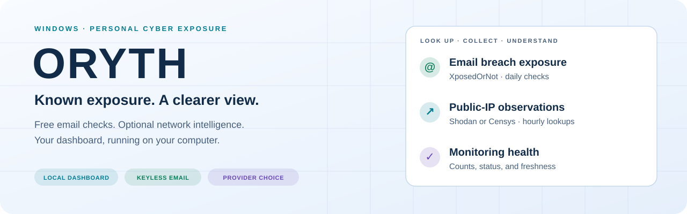
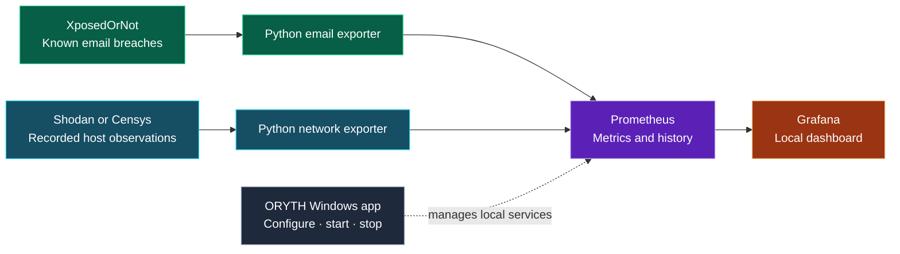

<picture>
  <source media="(prefers-color-scheme: dark)" srcset="docs/assets/hero-dark.svg">
  <source media="(prefers-color-scheme: light)" srcset="docs/assets/hero-light.svg">
  
</picture>

### Known exposure. One local dashboard.

Free email-breach checks, optional Shodan or Censys observations, and clear monitoring health — managed from a Windows desktop app.

[Features](#-what-you-get) · [Quick start](#-start-here) · [Architecture](#-how-data-moves) · [Documentation](#-explore-the-docs) · [Validation](#-verified-windows-preview)

> [!TIP]
> **No Python, WSL, or container setup required for the Windows download.** Extract the ZIP, open `ORYTH.exe`, and enter your settings. First start downloads and verifies the dashboard components.

## ✨ What you get

| | Feature | What it does |
| :---: | --- | --- |
| 🟢 | **Email breach exposure** | Free, keyless daily checks with XposedOrNot. View per-address counts and a complete total when all lookups succeed. |
| 🔵 | **Your choice of network provider** | Select Shodan or Censys for hourly lookups of recorded ports and services on your public IP. |
| 🟣 | **Monitoring you can inspect** | See which provider is selected, whether checks succeeded, and how old the last successful result is. |
| 🟠 | **A local dashboard** | Prometheus records measurements; Grafana displays them. Both listen on your own computer. |
| 🟢 | **Desktop control** | Start, stop, prepare components, copy the dashboard password, and open your data folder from one window. |
| 🔵 | **Honest failure states** | Failed lookups stay unknown. Unavailable data is never silently reported as zero exposure. |

## 🚀 Start here

1. Download **`ORYTH-Windows-x64.zip`** from [Releases](https://github.com/Anandhasasidharan/ORYTH/releases).
2. Extract the ZIP and double-click **`ORYTH.exe`**.
3. Enter the email addresses you want to monitor. Network monitoring is optional: select **Shodan** or **Censys**, then enter your public IP and your own provider credential.
4. Click **Start monitoring** and allow first-run component preparation to finish.
5. Click **Copy password**, then **Open dashboard**. Sign in as **`admin`** with the copied password.

**Windows 10/11 x64 · Internet required · Keep the app window open while monitoring**

The executable is an unsigned preview. Closing it stops the local services. [Full setup guide →](docs/GETTING_STARTED.md)

## 🧭 How data moves

The arrows show data flow. Prometheus **pulls** metrics from the exporters every **15 seconds**; provider lookups run roughly **hourly** for network data and **daily** for email data. The desktop app manages all four local processes. [Architecture and timing →](docs/ARCHITECTURE.md)

> [!NOTE]
> ORYTH reads existing provider records. It does **not** submit active scans, predict attacks with AI, or guarantee that an address is safe when no matching data is found.

## 📚 Explore the docs

| Guide | What you will find |
| --- | --- |
| [🚀 Getting started](docs/GETTING_STARTED.md) | Windows setup, credentials, first-run downloads, and everyday use |
| [🧩 Architecture](docs/ARCHITECTURE.md) | Components, schedules, process lifecycle, metrics, and source-code map |
| [🛠️ Development](docs/DEVELOPMENT.md) | Source setup, Windows builds, tests, and release automation |
| [🔒 Privacy and data](docs/PRIVACY.md) | Which providers receive data, local storage, credentials, and limitations |
| [🩺 Troubleshooting](docs/TROUBLESHOOTING.md) | Startup, port conflicts, download issues, authentication, and unknown results |
| [✅ Validation record](VALIDATION.md) | Recorded Windows test and release evidence |
| [🤝 Contributing](CONTRIBUTING.md) | Development practices and safe test data |
| [📦 Third-party components](THIRD_PARTY.md) | Runtime components, sources, and licenses |

## ✅ Verified Windows preview

The [v0.3.0 build](https://github.com/Anandhasasidharan/ORYTH/actions/runs/44070440175) passed:

| Automated tests | Packaged provider modes | Dashboard queries per mode |
| :---: | :---: | :---: |
| **99 passed on Windows** | **Shodan + Censys** | **11 passed** |

The workflow also checked packaged desktop startup, provider-switch credential retention, expected synthetic metrics, native Grafana/Prometheus startup, cleanup, and the distribution checksum. These are recorded release results; the build and release badges above update independently.

<strong>Why does the app download Prometheus and Grafana?</strong>

Prometheus stores numerical measurements over time. Grafana turns them into the dashboard. The desktop app downloads their official binaries on first start, verifies publisher SHA256 checksums, and reuses them later. [Details →](docs/ARCHITECTURE.md#the-two-dashboard-components)

<strong>Do I need a paid API key?</strong>

Email checks use the free XposedOrNot endpoint without a key. Network monitoring is optional and requires your own provider credential. Shodan host lookup requires suitable account access; having a key alone may not grant it. Censys access depends on the account's entitlements. [Provider setup →](docs/GETTING_STARTED.md#choose-your-monitoring-options)

<strong>Where are my settings and results stored?</strong>

Under `%LOCALAPPDATA%\ORYTH` for your Windows account. Provider credentials are not bundled in the app or CI, but settings are not encrypted by this implementation. Email addresses and the selected network target are sent to their respective providers when monitoring starts. [Privacy details →](docs/PRIVACY.md)

---

**Understand what is known. See when a check fails. Stay in control of your monitoring.**

[Download](https://github.com/Anandhasasidharan/ORYTH/releases) · [Read the docs](docs/README.md) · [Report an issue](https://github.com/Anandhasasidharan/ORYTH/issues)

