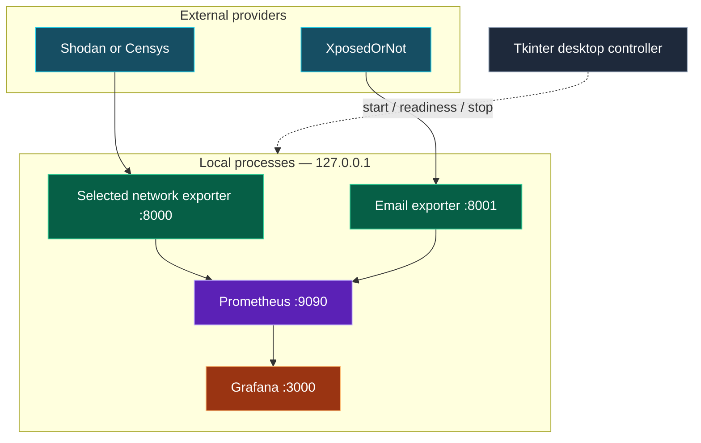

# 🧩 Architecture

[← Overview](../README.md) · [Docs index](README.md) · [Development](DEVELOPMENT.md)

## Components and data flow

Arrows represent data flow, not who initiates an HTTP request. Exporters call the providers; Prometheus pulls exporter metrics; Grafana queries Prometheus.

## The two dashboard components

**Prometheus** collects numerical measurements and stores time series. **Grafana** queries those measurements and displays panels. Grafana's own SQLite database stores its application/account data; monitoring history belongs in Prometheus.

The desktop window manages setup and lifecycle. The charts open in a browser; they are not drawn inside Tkinter. Slow startup/download operations use a background thread and queue, with GUI updates kept on Tk's main thread.

## Three different clocks

| Work | Schedule |
| --- | --- |
| Local metrics collection | Prometheus scrapes every **15 seconds** |
| Network lookup | After configured startup, then roughly **hourly** |
| Email lookup cycle | After configured startup, then roughly **daily** |
| Metric retention | **30 days** |

Lookup intervals include processing and backoff time. Requesting a provider record does not force that provider to rescan. ORYTH does not perform active or on-demand port scans, predict attacks, or supply an authoritative overall risk score.

## Metrics and health

Provider-neutral measurements include `network_observed_ports`, `network_observed_services`, `network_lookup_success`, `network_monitor_enabled`, `network_last_success_timestamp_seconds`, and `network_provider_info`. Provider-specific aliases remain for compatibility.

Email measurements use `xposedornot_` metrics with email labels. Three signals answer different questions:

- **Enabled:** is the integration configured?
- **Lookup success:** did the last external request succeed?
- **Prometheus `up`:** can the exporter endpoint be reached?

A healthy exporter can have a failed external lookup. Failed counts become unknown; a total email count is only shown when all configured address lookups succeed.

## Lifecycle and persistence

The manager checks ports, prepares verified runtimes, creates data directories, writes provisioning, launches services, and waits for local readiness. Startup failure or cancellation stops already started child processes. Stop/close terminates and waits for the managed processes.

Snapshots are written through a temporary file and atomic replacement. A failed lookup preserves the previous successful file, without loading it as a fresh result on the next startup.

## Source map

| File / directory | Responsibility |
| --- | --- |
| [`oryth_app.py`](../oryth_app.py) | Desktop entry point, packaged exporter workers, self-test flags |
| [`oryth/desktop.py`](../oryth/desktop.py) | Window, provider selector, worker thread and UI queue |
| [`oryth/settings.py`](../oryth/settings.py) | Validation and per-user settings |
| [`oryth/runtime.py`](../oryth/runtime.py) | Downloads, checksums, safe extraction and cache |
| [`oryth/services.py`](../oryth/services.py) | Provisioning, processes, readiness and cleanup |
| [`scripts/`](../scripts/) | Shodan, Censys and XposedOrNot exporters; shared metrics helpers |
| [`grafana/`](../grafana/) / [`prometheus/`](../prometheus/) | Dashboard and collection templates |
| [`oryth/selftest.py`](../oryth/selftest.py) | Real local stack with synthetic provider responses |

[Privacy boundaries →](PRIVACY.md) · [Build and tests →](DEVELOPMENT.md)
